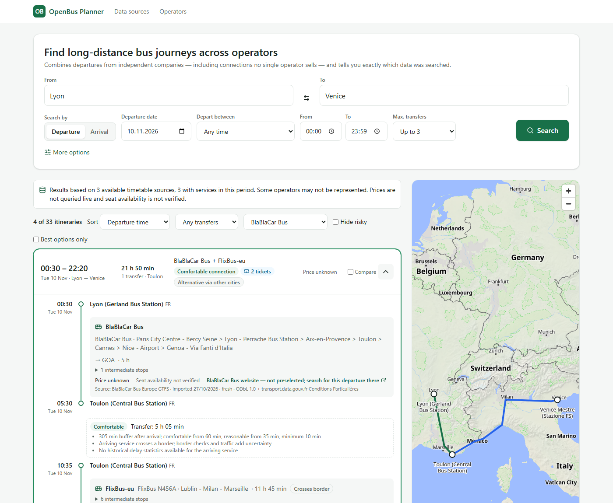

# OpenBus Planner

**Live demo: [openbus.pcngroup.ch](https://openbus.pcngroup.ch)** · developed by PCN Group



An operator-independent, schedule-aware planner for long-distance bus journeys in Europe. Given two
cities and a desired **departure or arrival time**, it searches *dated* departures from every
imported timetable and combines unrelated operators on separate tickets. Transfer cities are
found algorithmically: Milan, Munich, Innsbruck and the rest are never hardcoded. The planner
classifies how risky each connection is and reports exactly which data it searched.

It is a discovery and referral tool. It does not sell tickets, and it never presents timetable
existence as ticket availability.

The public demo uses only real, openly licensed timetables (FlixBus, BlaBlaCar Bus and German
long-distance rail; see [Data sources](https://openbus.pcngroup.ch/sources)). Prices and seat
availability are not yet connected, and operators that publish no open data are not included.

**Operators and data publishers:** we would like to add your network, with the attribution
and licence you require, and to link each journey to your own booking site. Please contact
Niccolò Cavallini, PCN Group: n.cavallini@bluewin.ch.

## Quick start (Docker)

```bash
docker compose --profile app up --build
```

- Web: http://localhost:3000. API: http://localhost:4080, with docs at http://localhost:4080/api/docs.
- Without configuration the stack imports only the **synthetic test fixtures** used by the tests. Every itinerary built from them
  carries a purple "Test data" label: none of those departures exist.
- For real open data (FlixBus, BlaBlaCar Bus, German long-distance rail), read the licences in
  [docs/data-sources.md](docs/data-sources.md) first, then run:

  ```bash
  ENABLED_SOURCES=default,flixbus-eu-gtfs,blablacar-bus-gtfs,gtfs-de-fv docker compose --profile app up --build
  ```

- For a public deployment like the demo, copy `.env.example` to `.env`. It enables the real
  sources and sets `DISABLE_FIXTURES=1`, so test data is never imported, searched or listed.

Try the spec scenario on the fixtures: **Zürich → Bolzano, Arrival, 2026-11-08, Early morning
(04–08)**, *More options* → depart no earlier than 2026-11-07 12:00. Or open:
`http://localhost:3000/?from=city:ch-zurich&fromName=Zürich&to=city:it-bolzano&toName=Bolzano&mode=arrive&date=2026-11-08&wf=04:00&wt=08:00&nbd=2026-11-07&nbt=12:00&scope=synthetic`

## Local development

Requirements: Node ≥ 22, pnpm 9 (`npm i -g pnpm@9.15.0`), Docker.

```bash
pnpm install
pnpm services:up                 # PostGIS on :55432, Redis on :56379
pnpm db:seed                     # migrate + reference data + fixture sources
pnpm ingest import flixbus-eu-gtfs   # optional: real data (~50 s)
pnpm --filter @openbus/api dev   # API on :4080 (REDIS_URL=redis://localhost:56379 for caching)
pnpm --filter @openbus/web dev   # web on :3000
```

| Command | What it does |
|---|---|
| `pnpm test` | Unit tests (router, GTFS, core, ingest, API helpers): 165 tests, no services needed |
| `pnpm test:integration` | PostgreSQL/PostGIS integration tests (needs `pnpm services:up`; uses database `openbus_test`) |
| `pnpm test:e2e` | Playwright on desktop and mobile (needs a seeded DB, the API on :4080 and `pnpm --filter @openbus/web build`) |
| `pnpm exec vitest run packages/router/test/raptor.test.ts -t "walking"` | A single test file or test |
| `pnpm typecheck` / `pnpm lint` | Types and ESLint across the workspace |
| `pnpm bench` | Router benchmark ([results](docs/benchmarks/README.md)) |
| `pnpm ingest list \| health \| seed \| import <id> [--force] \| realtime <id>` | Ingestion CLI |

## How it works

- **Routing**: multi-criteria RAPTOR over dated trips. The criteria are arrival, departure,
  transfers, walking, worst connection class and known price. Arrival searches run the same
  engine on a time-mirrored timetable. Pareto-optimal results are complemented with "corridor
  alternatives" found by excluding already-used transfer cities. The engine is verified against
  exhaustive enumeration on random networks, in both directions.
  [Architecture](docs/architecture.md) · [ADR](docs/adr/0001-architecture-and-routing-engine.md)
- **Data**: provider adapters cover GTFS URL/file, GTFS-Realtime, manual JSON timetables,
  NeTEx (interface only) and stand-ins for unavailable operators. Entity resolution merges feed
  stops into stations by geography and name, never by city name alone, and groups them into
  multilingual cities. Data lives in PostgreSQL + PostGIS. [Database](docs/database.md)
- **Honesty**: every leg carries provenance (source, licence, import time, freshness, synthetic
  flag). Prices are *indicative* and totals appear only when every leg is priced. Availability is
  `not_verified`. Connections are classed comfortable / reasonable / risky with reasons, never
  probabilities. The coverage statement is generated from what the search actually touched.
- **API**: versioned REST under `/api/v1`, documented with OpenAPI. [API docs](docs/api.md)

## Repository layout

```
packages/core     domain: time zones/GTFS times, geo, names, transfer model, gazetteer, API schema
packages/router   McRAPTOR engine, timetable structures, journeys
packages/gtfs     GTFS reader/validator, calendars, fares, GTFS-RT
packages/db       migrations, window loader, queries
packages/ingest   registry, adapters, import pipeline, entity resolution, CLI
packages/bench    router benchmark
apps/api          Fastify API        apps/worker  BullMQ worker        apps/web  Next.js UI
data/             source registry, research, fixtures (synthetic, clearly labelled)
docs/             architecture, ADR, database, API, data sources, deployment, limitations, roadmap
```

## Status

What works today, verified on the development machine on 2026-10-26:

- Real imports of the FlixBus EU, BlaBlaCar Bus and gtfs.de long-distance rail feeds, with real
  multi-operator itineraries, e.g. BlaBlaCar Lyon → Milan + FlixBus Milan → Venice.
- The full synthetic Zurich → Bolzano scenario with exact expected results.
- Docker Compose stack.
- 165 unit, 15 integration and 14 browser tests passing.
- Public demo at [openbus.pcngroup.ch](https://openbus.pcngroup.ch) with real data only (since 2026-10-27).

See [docs/limitations.md](docs/limitations.md), especially on coverage: several operators named
in the spec publish no open data. See also the [roadmap](docs/roadmap.md) and the
[deployment guide](docs/deployment.md).

## Licences of data

Timetable data belongs to its publishers and is used under their licences (ODbL 1.0 for FlixBus
and BlaBlaCar Bus via transport.data.gouv.fr, CC BY 4.0 for GTFS.DE, …). Attribution is shown with
every leg and on `/sources`. Map tiles: OpenFreeMap, © OpenStreetMap contributors.
