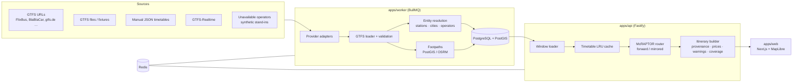

# Architecture overview

## Packages

| Package | Responsibility |
|---|---|
| `@openbus/core` | Time zones and GTFS service-day maths (`serviceDayReference`), geo, name normalisation, transfer-feasibility model, city gazetteer, versioned API schema (zod) |
| `@openbus/router` | Dated-trip timetable (RAPTOR routes, forward and time-mirrored views), McRAPTOR engine, journey reconstruction, alternatives, Pareto/dedup |
| `@openbus/gtfs` | Streaming GTFS reader (zip or directory), validation and duplicate handling, calendar expansion, zone fares, GTFS-RT decoding/applying, in-memory conversion |
| `@openbus/db` | Migrations, the window loader that builds router input from the database, place/operator/source queries |
| `@openbus/ingest` | Source registry, provider adapters, import pipeline, entity resolution, footpaths, manual JSON format, CLI |
| `@openbus/bench` | Router benchmark |
| `apps/api` | REST API (`/api/v1`), OpenAPI docs, search orchestration, Redis result cache, internal ingestion/diagnostics API |
| `apps/worker` | Seeding, scheduled refresh per source, realtime polling, health checks |
| `apps/web` | Search UI, results timeline, filters, comparison, map, data-source transparency pages |

## Request flow: `POST /api/v1/journeys/search`

1. **Validate** with the shared zod schema (`JourneySearchRequest`).
2. **Resolve places**: `city:<id>` → all stations of the city; `station:<id>` → that station.
3. **Window**: local date + time window in the time zone of the origin (departure mode) or
   destination (arrival mode). Windows that wrap past midnight are supported. Hard bounds come
   from `departureNotBefore` / `arrivalNotAfter`, or from the window ± maximum duration.
4. **Timetable**: dated trips for the UTC dates covering the bounds are loaded from the DB. The
   loader also takes service days up to two days earlier, because overnight trips belong to the
   previous service day. The result is cached by (dates, scope, data version). Exact duplicates
   across sources (same operator, stops and times) are merged; the other sources go to
   `provenance.alsoFoundIn`.
5. **Route** (async, yields to the event loop so client disconnects cancel the search):
   - departure mode: forward McRAPTOR from the origin stations with the departure window as the
     range of first boardings;
   - arrival mode: the same engine on the mirrored timetable from the destination stations;
   - optional corridor alternatives: re-run with the transfer cities found so far excluded.
6. **Build itineraries**: legs with local times + IANA zones, intermediate stops, connection
   quality and reasons, separate-ticket and other warnings, per-leg price, booking links
   (classified departure-specific / route search / operator homepage / none) and provenance
   (source, licence, import time, freshness, realtime applied).
7. **Coverage**: one entry per enabled source (`used`, `no_service_in_window`, `unavailable`,
   `stale`, `excluded_by_scope`) with the trip count in the window, plus a generated message.
8. **Persist** the search log and itinerary snapshots (`GET /api/v1/journeys/:id`), and cache the
   response in Redis for 5 minutes.

## Routing engine in detail

Labels carry `(arr, dep, legs, walk, quality, price)` plus a parent pointer. Per round *k*:

1. For each route through a stop improved in round *k−1*, scan from the earliest such position:
   - alight riders where drop-off is allowed (new labels, price += segment fare or *unknown*);
   - board labels waiting at this stop. A first boarding enumerates **every** departure in the
     start window (profile search). A transfer enumerates departures from
     `arrival + max(user minimum, station minimum)` up to the maximum wait. For each it computes
     the connection class and keeps the earliest trip per class, plus up to four more on routes
     with fares, where a later trip may be cheaper.
2. Relax footpaths from stops reached by vehicle (one walk per transfer, no chaining).
3. Prune with: Pareto bags per stop, target-bag dominance using an admissible lower bound
   `distance / max_observed_speed`, maximum duration, budget, and the time budget.

A journey never transfers at an origin or destination stop, and never re-boards the trip it
arrived on. Correctness is checked against an exhaustive enumerator on 120 random networks
(depart and arrive, with and without fares) in `packages/router/test/raptor.test.ts`.

## Transfer feasibility model (`@openbus/core/transfer`)

| | Comfortable from | Reasonable from | Hard minimum |
|---|---|---|---|
| Base (balanced) | 45 min | 20 min | max(user min, station min) |
| + inbound crosses a border | +15 min | +15 min | |
| + walk to another stop | +10 min | +10 min | |
| + walk at night (00–05) | +10 min | +10 min | |
| × preference | cautious ×1.5, adventurous ×0.67 | | |
| With ≥20 delay samples | ≥ p90 + 10 min | ≥ p50 + 10 min | |

Below the hard minimum, or above the maximum wait, a connection is infeasible. Every connection
carries the human-readable reasons. No probabilities are invented.

## Time handling

GTFS times are offsets from *noon minus 12 h* of the service day in the agency time zone. The
loader converts them to absolute epoch seconds once, so cross-midnight, overnight (+24 h), DST
days and border crossings are all handled by plain integer comparisons in the router. Times are
shown in each stop's own time zone, with `+N` markers computed from local calendar dates.
