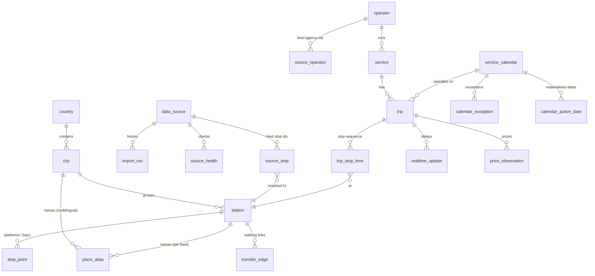

# Database design

PostgreSQL 16 + PostGIS 3.4 (`pg_trgm` for fuzzy place search). Schema:
`packages/db/migrations/0001_init.sql`. Migrations are applied automatically by the API and worker,
or by hand with `pnpm db:migrate`.

## Entities

| Table | Notes |
|---|---|
| `country`, `city` | Seeded from the gazetteer (`@openbus/core/gazetteer`). Cities created for stops outside the gazetteer are `origin = 'derived'`. |
| `station` | Physical stop after entity resolution: stable id, coordinates (`geography`), IANA time zone, `kind` (bus/rail), `min_transfer_seconds`. |
| `stop_point` | Platforms or bays when feeds provide them. |
| `place_alias` | All names a city or station is known by: gazetteer languages plus every feed spelling. Trigram index for autocomplete. |
| `data_source` | One row per registry entry: adapter, licence, attribution, **`synthetic`**, `enabled`, priority, research record. |
| `import_run` | Every attempt: status (`success`, `skipped_unchanged`, `failed`), content hash, feed version, validity range, stats, warnings. The basis for *verified working* and *freshness*. |
| `source_health` | Health checks (HEAD requests, realtime pulls) with latency. |
| `source_stop` | (source, feed stop id) → station, with `match_method` and `match_confidence`. Re-imports reuse it, so station ids stay stable. |
| `operator`, `source_operator` | Operators unified across feeds by normalised name; booking-link policy per operator. |
| `service` | GTFS route per source; `mode` (bus/rail/other). |
| `service_calendar`, `calendar_exception`, `calendar_active_date` | Weekly pattern + exceptions; operating dates materialised for a horizon (default today−30 … today+365) for fast window loads. |
| `trip`, `trip_stop_time` | Offsets in seconds from the GTFS service-day reference (noon − 12 h, agency time zone); pickup/drop-off flags; original `stop_sequence`. |
| `fare_product`, `fare_rule` | GTFS fares v1 (zone based), turned into per-segment indicative fares at load time. |
| `price_observation` | Explicit prices per dated leg (`indicative` or `live`), e.g. from a licensed fare API. They take precedence over zone fares. |
| `transfer_edge` | Walking links between distinct stations within 1 km: `estimated`, `pedestrian_router` (OSRM) or `feed` (transfers.txt). |
| `realtime_update` | Latest GTFS-RT TripUpdate per dated trip (6 h retention). |
| `delay_stat` | Per service and station delay percentiles — the hook for empirical connection risk (not yet populated: no historical data collected). |
| `search_log`, `itinerary_snapshot` | Search transparency and `GET /journeys/:id` (7 days). |

## Identifiers

- Stations `stn_<random>`: created once and then reused through `source_stop`.
- Operators `op_<hash(normalised name)>`: deterministic, so the same company from two feeds is
  one operator.
- Trips, services, calendars `<source id>:<feed id>`: namespaced per source, so feeds can never
  collide.

## Import semantics

- Unchanged content (same SHA-256 as the last successful import) is skipped.
- Otherwise the source's services, calendars, trips, stop times, fares and stop mappings are
  replaced in **one transaction**, so readers never see a half-imported feed. Stations are shared
  and are never deleted by a re-import.
